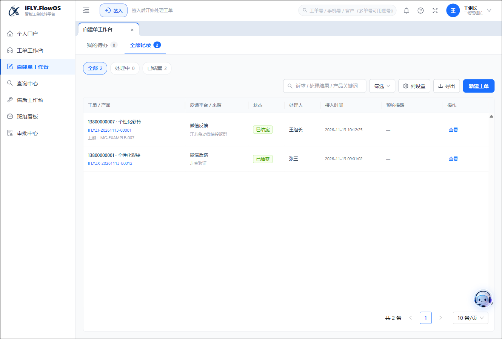
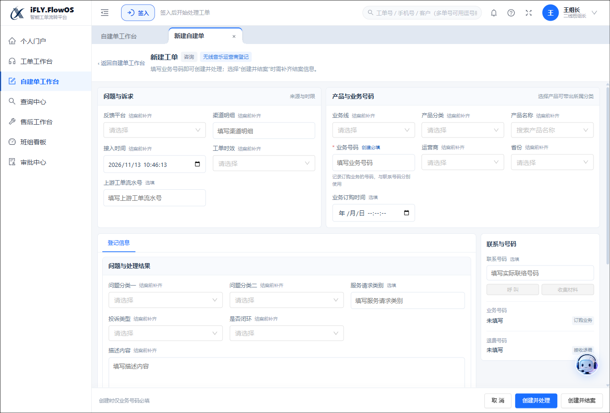
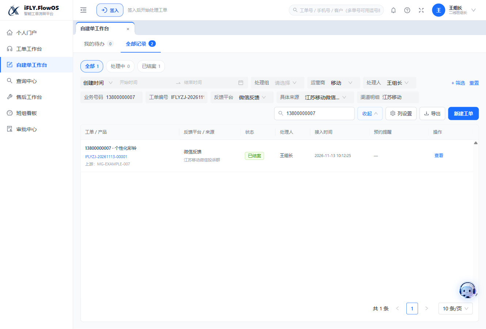

# 无线音乐运营商自建单需求说明

## 一、业务目标与范围

运营商通过咪咕、微信、QQ 等渠道反馈任务，由无线音乐处理组人工登记、处理和回单。平台新增独立的“自建单工作台”，承接本业务的新建、列表、处理、查询与导出。

自建单工作台与原工单工作台并列，使用同一平台的登录、租户、人员、导航和基础组件；无线音乐运营商自建单拥有独立入口、办理路由及数据范围。原工单工作台、统一建单及查询中心不承载此类自建单。原有 400 流程中产品涉及无线音乐的普通工单继续按原流程办理，不因产品名称相同迁入自建单工作台。

本业务使用“无线音乐运营商登记”表单，业务类型为无线音乐，工单业务分类沿用咨询。表内投诉类型用于运营商业务分类，不触发原平台投诉定性或流转。建单人自行处理，不自动分派，支持组内人工调剂；独立归集登记和结案数据，不计入通用咨询工单量。

本期包括登记、保存、提醒、调剂、结案、结案修订、附件、联系记录、材料收集入口、字典与产品维护、查询导出。质检退回重提、质检和班组看板后续建设。旧业务系统数据不迁移，新系统只建新单；本次原型中已保存的自建单记录及其附件、履历和提醒继续保留。

## 二、入口与办理流程

### 2.1 工作台与列表

左侧菜单在“工单工作台”之后新增“自建单工作台”。工作台沿用现有工单工作台的视觉和交互结构：贴顶范围页签、状态快捷项、列表工具栏、可展开／收起的筛选区、列设置、表格和分页。进入后展示无线音乐自建单列表，提供“我的待办”和“全部记录”范围。“我的待办”显示当前处理人为本人且未结案的单据；“全部记录”按当前账号有权查看的记录展示，包含已结案记录。

状态筛选为全部、处理中、已结案。工具栏提供新建、查询、筛选展开／收起、列设置及导出操作。业务号码、工单编号、运营商、处理组、处理人、来源和渠道明细分别检索，模糊内容用于检索描述及处理结果等文本，不将各业务字段合并成一个输入框。来源按反馈平台和具体来源联动。时间条件可选择创建、接入或回复时间，支持精确到时分秒的起止区间。产品、省份和问题分类等通过可选筛选加入；各条件共同作用于当前列表范围。

列表默认展示工单标识、号码与产品、来源、状态、处理人、接入时间和预约提醒，并按权限提供处理、查看及调剂操作。收起筛选区保留当前查询，移除可选字段时清空该字段条件；列设置调整当前工作台列的显示和顺序。分页、筛选和状态计数使用同一记录范围，不出现原工单SLA、派单、退回或工单池操作。

新建、返回列表、提醒跳转、号码检索和记录查看均在自建单工作台内完成。原工单工作台和统一建单不再提供本业务入口；原查询中心不混入自建单结果。

图1：1330×901视口下的自建单工作台，范围页签、状态快捷项、工具栏、表格和分页沿用平台工作台风格。

### 2.2 创建与保存

在自建单工作台点击“新建工单”，直接打开无线音乐运营商登记表单，不重复选择业务表单或工单类型，不增加确认页。新建页显示当前表单及只读咨询分类，尚未创建时不展示单号、建单人、建单时间和处理人。

| 操作 | 校验与结果 |
| --- | --- |
| 创建并处理 | 仅业务号码为创建必填；提交后生成正式工单、编号和创建记录，当前处理人为建单人，进入处理中并保留已填内容 |
| 创建并结案 | 校验全部结案必填项；通过后一次生成已结案工单，保留创建及结案时间；未通过时定位缺失项并保留填写 |
| 取消／返回自建单工作台 | 退出尚未创建的表单，不产生正式单据 |
| 保存 | 更新已登记的同一张工单，允许结案字段暂缺，不重复建单 |

业务号码标注“创建必填”，其他必填项标注“结案前必填”。个人未提交输入不作为正式登记，不参与调剂、提醒或工单计数。

图2：从自建单工作台直接新建，顶部来源时限和产品号码完整可编辑，业务号码为创建必填。

### 2.3 完整路径

常规办理：自建单工作台 → 新建工单 → 创建并处理 → 保存补充 → 提醒／组内调剂 → 补齐信息 → 结案 → 在本工作台查询或修订。

一次办结：自建单工作台 → 新建工单 → 填写完整信息 → 创建并结案 → 已结案。

新登记使用独立号段 `IFLYZJ-YYYYMMDD-00001`。此前原型已保存的 `IFLYZX` 编号及记录保持不变，旧链接兼容跳转至本模块；兼容跳转不恢复原工单列表或查询中心对自建单的承载。

## 三、处理页面

已登记页头显示状态、只读咨询分类、表单标识、标题、单号、建单人、建单时间和当前处理人。预约提醒时间及状态并入页头，底部保留设置和修改入口。

顶部左侧沿“问题与诉求”位置设置可编辑来源与时限区，包含反馈平台、具体来源、渠道明细、接入时间、工单时效和上游流水号。顶部右侧完整展示产品与业务号码，包括业务线、产品分类、产品名称、业务号码、运营商、省份和业务订购时间。

下方集中填写问题、处理结果、退费和附件；右侧仅保留联系号码、外呼及收集材料入口。不展示旧三张静态速览卡、客户档案、客户关联或处理归属卡。回复时间在表单，调剂记录进入处理履历。

创建成功后展示处理履历、联系记录、通知记录和附件历史，无记录时展示空态。处理中底部提供保存、预约提醒、调剂及结案；已结案由处理人通过“修订记录”进入修订，按权限保留附件操作。

图3：本模块独立详情页，页头展示实际单据信息，下方保留业务表单、记录及附件操作。

## 四、字段与校验

创建必填同时适用于后续保存；结案必填可在处理中暂缺，创建并结案及后续结案必须补齐。系统记录项不要求人工填写。尚未补齐的必填规则不新增强制拦截。

| 分区 | 字段 | 要求与规则 |
| --- | --- | --- |
| 产品与业务号码 | 业务号码 | 唯一创建必填，记录订购业务号码；不自动创建客户档案 |
| 产品与业务号码 | 业务线 | 结案必填，5G新通话业务部或数字娱乐业务部 |
| 产品与业务号码 | 产品分类、产品名称 | 结案必填，引用独立目录并支持搜索；按已配置映射带出分类及业务线，缺映射时允许手选业务线 |
| 产品与业务号码 | 运营商、省份 | 结案必填；生产要求按业务号码识别，当前原型手选；识别失败规则随服务对接补齐 |
| 产品与业务号码 | 业务订购时间 | 选填，有信息时填写 |
| 来源与时限 | 反馈平台 | 结案必填，引用业务字典并支持搜索 |
| 来源与时限 | 具体来源 | 微信／QQ 反馈时显示对应群选项；当前选填，必填规则待业务资料补齐 |
| 来源与时限 | 渠道明细 | 结案必填，自由填写，与具体来源分别记录 |
| 来源与时限 | 接入时间 | 结案必填，默认打开新建页时的当前时间，可人工修改，与系统创建时间区分 |
| 来源与时限 | 工单时效 | 结案必填，半小时、1小时、2小时或24小时，人工选择 |
| 来源与时限 | 上游流水号 | 选填，记录咪咕等上游单号，与本系统工单号区分 |
| 问题与处理 | 问题分类一、二 | 结案必填，按业务清单维护，不随产品变化 |
| 问题与处理 | 描述内容、处理结果 | 结案必填，长文本；处理结果含“附件”时提示补充附件 |
| 问题与处理 | 投诉类型、是否闭环 | 结案必填，业务分类不改变平台咨询分类或工单状态 |
| 问题与处理 | 服务请求类别 | 选填，自由填写 |
| 问题与处理 | 回复时间 | 系统记录，保存、结案时生成；结案修订不刷新原回复时间 |
| 退费与凭证 | 退费号码、退费金额 | 选填，退费号码可与业务号码不同 |
| 退费与凭证 | 附件 | 选填，展示文件、上传人和时间，支持多次补充 |
| 联络区域 | 联系号码 | 选填，用于联系及材料邀请，与业务号码分别记录 |
| 页头及底栏 | 预约提醒 | 选填，由处理人选择明确未来时间 |

删除开通渠道、业务号码年龄、超时工单备注和本步意见。工单时效只记录运营商要求，不自动启动原工单 SLA，不自动推算预约提醒时间。

## 五、状态、权限及修订

正式自建单仅使用处理中和已结案两个办理状态。创建并处理进入处理中，创建并结案直接进入已结案；保存、提醒和调剂不增加状态。处理组及人员使用平台现有组织关系，不能仅凭页面入口获得办理权限。

| 操作 | 当前处理人 | 同组其他成员 | 组外人员 |
| --- | --- | --- | --- |
| 查看 | 可 | 可 | 按自建单工作台查看权限，只读 |
| 编辑业务内容 | 可；已结案通过修订 | 不可 | 不可 |
| 保存、结案 | 可；结案仅限未结案 | 不可 | 不可 |
| 调剂 | 已保存未结案可 | 已保存未结案可 | 不可 |
| 设置、修改提醒 | 未结案可 | 不可 | 不可 |
| 上传附件 | 可，含结案后 | 可，含结案后 | 不可 |
| 删除附件 | 仅本人上传 | 仅本人上传 | 不可 |

调剂仅可选择当前处理组的其他成员，提交后立即变更处理人，无需接收确认；前后处理人、操作人和时间进入履历，交接说明选填。本期不提供批量调剂。

已结案时，当前处理人指结案时的处理人。修订保持已结案，保留原结案及回复时间，另记修改人、修改时间和字段前后值，不重复增加工单量或结案次数。

## 六、提醒、附件及联系

预约提醒与预约回访分别使用。正式登记后，当前处理人可设置明确未来时间；到时在平台工作区弹窗，切换页面后仍可收到，点击打开自建单处理页。调剂时未触发提醒保留时间并改为提醒新处理人；结案取消未触发提醒。关闭浏览器及跨设备送达由生产消息服务验收。

同组成员可补充附件，仅上传本人可删除。处理结果包含“附件”二字时忽略空格匹配，保存或结案前给出非强制提示，允许继续办理。

外呼、联系记录和录音按本单关联；业务号码用于检索本工作台的相关自建单，不视为客户身份。客户材料通过短信链接收集，短信与上传页面统一使用业务提供的客服名称，不显示科大讯飞。当前交互稿仅记录演示外呼及材料邀请，真实电话、短信、上传页及录音回传另行接入。

## 七、配置、查询及统计

无线音乐自建单产品目录与 400 工单目录分别维护，复用平台既有后台字典和产品管理入口，通过表单范围区分。管理员可新增、启用和停用选项及产品；停用项不供新选择，历史原值继续展示并允许原样保存、结案和修订。产品业务线归属按配置带出，不推测原材料未给出的归属。

查询和导出位于自建单工作台。查询条件以自建单记录及独立目录为准，停用和历史来源、产品仍可检索。创建、接入和回复时间分别按对应字段匹配，不以更新时间代替；起止时间支持到秒。列表、状态计数、分页和导出使用同一权限及筛选范围，默认按更新时间倒序。系统内明细导出按创建时间限定近三个月，更长跨度的观星台对接另行落实。

图4：展开自有业务字段筛选，业务号码、工单编号、来源、渠道、运营商及处理人组合后，列表和状态计数同步收敛。

登记量按创建时间归集，结案量按首次结案时间及结案处理人归集；保存、调剂和修订不重复计数。本业务记录不进入原工单集合、原工作台计数、原查询结果或通用咨询工单量。未来如建设平台跨业务总览，应显式定义汇总口径，不以混写原工单数据实现。

## 八、验收标准及交付边界

| 场景 | 预期结果 |
| --- | --- |
| 独立入口 | 同一平台左侧可进入自建单工作台，新建、处理及返回列表均在本模块 |
| 原系统隔离 | 创建、修改、调剂及结案不改变原工单工作台、查询中心或通用咨询计数；原普通无线音乐工单仍按原流程 |
| 最小登记及一次办结 | 仅业务号码可创建并处理；创建并结案执行完整校验且只生成一张工单 |
| 页面与字段 | 顶部左右编辑区完整，订单时间选填，无客户档案及归属卡，阶段标注准确 |
| 权限及调剂 | 仅处理人编辑和结案；同组可补附件、调剂；组内转交即时生效且记录履历 |
| 提醒 | 转交保留时间并变更接收人，跨页触发，打开本模块正确工单，结案后待提醒取消 |
| 结案修订 | 保持终态及原结案／回复时间，保留字段前后值，不重复计数 |
| 配置联动 | 字典和独立目录新增／启停与前台同步，历史停用值不误拦办理 |
| 工作台交互 | 贴顶页签、状态快捷项、工具栏、筛选展开收起、列设置及分页与现有工单工作台风格一致 |
| 查询导出 | 各业务字段分别检索，可选筛选有效；权限、筛选、状态计数和明细一致；创建／接入／回复时间按对应字段精确到秒筛选 |
| 已有记录及链接 | 本原型已保存的记录、附件、履历及提醒保留；旧业务入口链接兼容到新模块 |

原型使用浏览器本地记录验收页面、操作、权限和数据边界；生产须验证真实数据服务、稳定人员标识、并发事务、文件服务、号码归属、短信及上传页品牌、录音回传和消息送达。后台自由布局发布、质检和班组看板不属于当前交付能力。
