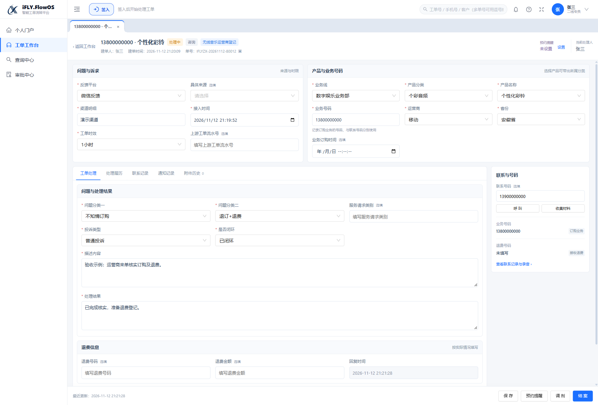

# 无线音乐运营商自建单需求说明

## 一、业务目的与范围

运营商通过咪咕、微信、QQ 等渠道反馈任务，由二线人员人工登记、处理及回单。系统需承接业务留痕、时限提醒、组内交接、材料收集和退费记录，并融入现有工单工作台、统一建单、处理页及查询中心。

本文定义建设要求；当前交互稿已覆盖的办理能力、演示操作和生产待接入能力分别列于交付边界，不以页面入口的存在代表外部服务已接通。

业务类型为无线音乐，平台工单类型为咨询，使用“无线音乐运营商登记”业务表单。建单人自行处理，不自动分派；表内投诉类型仅用于运营商业务分类，不触发平台投诉定性。工单按表单独立统计，不计入通用咨询工单量。

本期包括创建、保存、提醒、调剂、结案、结案修订、附件、外呼录音、客户材料收集、字典维护和查询导出。质检退回重提、质检及班组看板后续建设。不迁移旧数据：新系统只建新单，旧单继续在旧系统处理和查询。400 进线按其对应流程办理。

## 二、入口与办理流程

### 2.1 新建入口

工单工作台提供“无线音乐自建单”保存视图，按本表单筛选，提供我的待办、本组记录及已办范围；状态快捷项使用全部、处理中、已结案。用户点击“新建工单”，在统一建单页选择业务表单；从本保存视图新建时预选表单，无需重复选择。咨询类型随表单只读显示，不重复选择类型，不增加确认页。

新建页显示“新建工单”和当前表单，尚未创建时不展示单号、建单人、建单时间和处理人。业务号码明确标为“创建必填”，其他必填项标为“结案前必填”。

| 操作 | 校验与结果 |
| --- | --- |
| 创建并处理 | 业务号码必填；一次提交后生成正式工单、编号及创建记录，归建单人负责，进入处理中，保留已填内容 |
| 创建并结案 | 一次提交并校验全部结案必填项；通过后生成同一张已结案工单，保留创建、结案时间；未通过则定位缺失项，停留新建页 |
| 取消／返回工作台 | 退出尚未创建的表单，不生成正式工单 |

正式登记后的“保存”更新已有工单，可持续补充信息。个人草稿是尚未登记的输入内容，与本业务的保存处理区分；不作为已登记任务参与调剂、提醒及专项计数。

图 1：真实 Vue 交互稿的新建页面，创建必填与结案前必填分别标注。

### 2.2 完整流程

常规办理：工作台 → 新建工单 → 页内选择业务表单 → 创建并处理 → 保存补充 → 提醒／组内调剂 → 补齐必填项 → 结案 → 查询或修订。

一次办结：新建页填写完整信息 → 创建并结案 → 已结案。

从工作台或查询中心打开同一张工单，使用同一处理页。结案修订保持已结案，不重新打开，保留原结案时间及修改记录。

## 三、页面组织

### 3.1 页头及顶部表单

已登记页头展示真实状态、咨询类型、表单标识、标题、单号、建单人、建单时间和当前处理人；预约提醒时间及状态并入页头。新建阶段不展示尚未产生的单据及人员信息。

顶部左侧将原“问题与诉求”位置调整为可编辑的“来源与时限”，包含反馈平台、具体来源、渠道明细、接入时间、工单时效和上游流水号。顶部右侧为完整的“产品与业务号码”，包含业务线、产品分类、产品名称、业务号码、运营商、省份和业务订购时间；创建必填的业务号码突出展示。

移除原客户全景、最新处理两张速览卡，不新增第三张速览卡。下方主表单承接诉求、处理结果、退费及附件信息；联络区域保留联系号码、外呼和收集材料入口。右侧客户档案卡、处理归属卡及客户关联入口移除，回复时间放在表单，调剂记录放在处理履历。

### 3.2 记录与操作

新建时不展示虚构的处理履历、联系、通知及附件历史。创建成功后展示对应记录页签，尚无记录时显示空态。

处理中底部提供保存、预约提醒、调剂、结案；已结案提供保存修订及按权限可用的附件操作。预约提醒时间在页头查看，设置或修改操作保留在底栏。

图 2：真实 Vue 交互稿的处理中页面。

## 四、字段与校验

“创建必填”同时适用于后续保存；“结案必填”可在处理中暂缺，创建并结案及后续结案时必须补齐。系统记录项由系统填写，不要求人工补齐。标注待补规则的字段当前不新增强制校验。

| 分区 | 字段 | 要求 | 规则 |
| --- | --- | --- | --- |
| 产品与业务号码 | 业务号码 | 创建必填 | 记录订购业务的号码，带出运营商和省份；不自动新建客户 |
| 产品与业务号码 | 业务线 | 结案必填 | 5G新通话业务部、数字娱乐业务部 |
| 产品与业务号码 | 产品分类、产品名称 | 结案必填 | 独立产品目录；支持搜索，选择产品名称反向带出归属分类及业务线 |
| 产品与业务号码 | 运营商、省份 | 结案必填 | 根据业务号码带出；识别失败的处理方式由对接时补齐 |
| 产品与业务号码 | 业务订购时间 | 选填 | 有信息时手动选择 |
| 来源与时限 | 反馈平台 | 结案必填 | 沿用业务选项，支持搜索 |
| 来源与时限 | 具体来源 | 条件选填 | 微信或 QQ 反馈时显示对应群选项；必填规则待补 |
| 来源与时限 | 渠道明细 | 结案必填 | 自由填写，与具体来源分开记录 |
| 来源与时限 | 接入时间 | 结案必填 | 默认打开新建页时的当前时间，可人工修改；区别于系统创建时间 |
| 来源与时限 | 工单时效 | 结案必填 | 半小时、1 小时、2 小时、24 小时，人工选择 |
| 来源与时限 | 上游流水号 | 选填 | 原工单流水号，记录咪咕等平台单号，区别于系统工单号 |
| 诉求与处理 | 问题分类一、二 | 结案必填 | 按业务清单维护，不随产品变化 |
| 诉求与处理 | 描述内容、处理结果 | 结案必填 | 长文本；处理结果含“附件”时提示补充附件 |
| 诉求与处理 | 投诉类型、是否闭环 | 结案必填 | 保留业务选项，与平台工单类型及状态区分 |
| 诉求与处理 | 服务请求类别 | 选填 | 自由填写 |
| 诉求与处理 | 回复时间 | 系统记录 | 保存、结案时自动记录；新建未提交时留空 |
| 退费与凭证 | 退费号码、退费金额 | 选填 | 仅记录业务信息，退费号码可与业务号码不同 |
| 退费与凭证 | 附件 | 选填 | 展示文件、上传人和时间，支持多次补充 |
| 联络区域 | 联系号码 | 选填 | 用于实际外呼、发送收集材料链接；必填规则待补 |
| 页头及底栏 | 预约提醒 | 选填 | 手动设置明确时间，页头显示，底栏操作 |

删除开通渠道、业务号码年龄、超时工单备注、本步意见。业务号码、联系号码及退费号码各自保留用途。工单时效记录运营商要求，不自动推算预约提醒时间。

## 五、状态、权限与修订

正式工单使用处理中、已结案两个办理状态。创建并处理进入处理中；创建并结案直接进入已结案。保存、提醒及调剂均不增加办理状态。已结案时，当前处理人指结案时处理人。

| 操作 | 当前处理人 | 同组其他成员 | 组外人员 |
| --- | --- | --- | --- |
| 查看 | 可 | 可 | 按平台查询权限，只读 |
| 编辑业务内容 | 可；已结案按修订执行 | 不可 | 不可 |
| 保存、结案 | 可；结案仅限未结案 | 不可 | 不可 |
| 调剂 | 已登记未结案时可 | 已登记未结案时可 | 不可 |
| 设置、修改提醒 | 未结案时可 | 不可 | 不可 |
| 上传附件 | 可，含结案后 | 可，含结案后 | 不可 |
| 删除附件 | 仅本人上传 | 仅本人上传 | 不可 |

调剂接收人仅限当前处理组成员，提交后立即变更处理人，无需接收确认。调剂前后人员、操作人及时间记入履历。原因必填和批量调剂不作为本期必做要求。

结案后处理人可修订业务内容，保留原结案时间，记录修改人、时间及修改前后内容；修订不增加工单或结案次数。系统编号、创建及结案时间不作为可修改的业务字段。设计约定：修订不刷新业务回复时间，另记最后修改时间。

## 六、提醒、附件与联系

### 6.1 通用任务提醒

正式登记后可设置预约提醒。提醒时间由处理人自行选择，区别于预约回访；到时在当前工作区弹窗，切换至其他工单或列表后仍可收到，点击进入对应工单。关闭浏览器后的送达能力另由消息服务对接明确。

调剂时，尚未触发的提醒保留原时间，接收人改为新处理人；结案取消尚未触发的提醒。页头展示未设置或已设置的时间及状态，底部保留操作入口。

### 6.2 附件及客户材料

同组成员可在保存及结案后补充附件，只有上传本人可删除其附件。处理结果含“附件”二字时，忽略空格匹配，在保存或结案时提醒上传；提醒不强制阻止办理，当前页完成校验和提示，不增加业务确认页。

通过短信链接收集图片、音频等材料，文件与本单关联。短信及上传页面统一使用业务提供的客服名称，不显示科大讯飞；具体名称、模板与上传页适配由生产对接落实。

### 6.3 外呼与号码检索

从本单联系号码入口外呼，联系记录及录音与本单关联，并可从本单查看。业务号码用于检索相关工单、联系记录，不直接作为客户身份。本表单不展示或要求客户档案关联，不自动建客户，不改变平台其他客户管理场景。

## 七、字典、查询与统计

无线音乐自建单产品目录与 400 工单目录分别维护，复用现有后台管理入口。管理员可新增、启用或停用下拉选项；设计约定：停用项不供新选择，历史记录保留原值。产品目录需补齐产品到业务线的完整归属关系；尚未配置归属的产品允许手动选择业务线，不推测归属，配置完整后按产品带出。反馈平台、投诉类型等沿用字典需核对完整选项。

工单号、业务／联系号码和上游流水号支持关键词检索；表单、状态、处理人、反馈平台、具体来源和独立产品目录提供条件筛选。日期条件选择创建时间或接入时间，默认创建时间，共用所选日期区间。“工单来源”与运营商反馈平台分别使用，不以人工登记来源替代微信、QQ、咪咕等反馈平台。停用及历史已用的来源、产品仍可作为检索条件。

明细导出包含本表单业务字段、工单编号、处理组、处理人及关键时间。系统内导出按创建时间限定近三个月；较长跨度经观星台导出的能力随生产数据对接落实，两处字段口径保持一致。

按本表单独立归集登记、结案及明细，不计入通用咨询工单量；该排除不扩展为统一查询不可见，也不直接排除平台全部工单总量。其他指标按其口径适配。设计约定：登记量按创建时间，结案量按首次结案时间及结案处理人计数；保存、调剂、修订不产生重复计数。

## 八、验收标准

| 场景 | 预期结果 |
| --- | --- |
| 真实新建入口 | 从工作台进入统一建单并选择表单；咨询只读，无额外确认页 |
| 最小登记 | 只填业务号码即可创建并处理；生成真实编号、人员和时间，刷新后可继续处理 |
| 一次办结 | 创建并结案执行完整校验，成功只生成一张已结案工单 |
| 分阶段校验 | 缺结案字段可保存；结案定位缺失项；业务订购时间为空不阻止结案 |
| 产品目录 | 根据已配置映射带出分类及业务线；缺业务线映射可手工补齐，不虚构归属 |
| 配置联动 | 既有字典／产品管理中新增或启停后同步到本表单；停用值不供新选，历史同值可保存、结案及修订 |
| 页面布局 | 顶部左来源时限、右完整产品与业务号码；无客户全景、最新处理、客户档案或归属卡 |
| 权限 | 同组可调剂和上传；仅处理人编辑、结案；组外按查询权限只读 |
| 调剂与提醒 | 仅组内未结案可调剂，立即生效；未触发提醒保留时间并转交新处理人 |
| 全局提醒 | 打开其他工单或列表后到时仍弹窗，点击打开正确工单，结案后不再触发 |
| 附件与录音 | 上传删除符合权限；含“附件”触发非强制提醒；联系及录音按本单关联 |
| 结案修订 | 修订保持已结案、保留原结案时间，履历记录修改内容，不重复计数 |
| 数据范围 | 可查本表单新单；不迁旧数据、不自动建客户；通用咨询量排除本表单 |
| 统一入口与导出 | 工作台和查询指向同一工单，修改后数据一致，专项明细按筛选导出 |

## 九、交付与验收边界

| 范围 | 当前交互稿与生产验收边界 |
| --- | --- |
| 办理主流程 | 真实 Vue 已接入统一入口、创建处理／结案、保存、组内调剂、全局提醒、修订及附件权限；按页面与本地记录验收 |
| 查询与导出 | 已接入表单、专用状态、处理人、业务／联系号码及上游单号关键词、来源及独立产品目录，日期按创建／接入时间二选一；登记明细另按创建时间限定近三个月。生产查询与观星台接入另行验收 |
| 号码归属 | 自动带出运营商、省份为建设要求；当前交互稿为手工选择，真实归属查询服务未接入 |
| 外呼与材料 | 当前仅记录演示外呼和材料邀请，不拨打电话、不发送短信，也未打通客户上传页面 |
| 录音与消息 | 已预留录音展示及浏览器工作区到时提醒；真实录音回传、关闭浏览器后或跨设备送达由生产服务验收 |
| 产品与字典 | 既有后台管理页已接入本地字典、产品新增／启停和归属维护；完整产品到业务线映射及沿用选项仍需补齐，按目录配置与表单联动验收 |

交互稿验收以本地操作与记录一致性为准；生产验收须验证实际权限、数据服务、短信及上传页品牌、录音回传和消息送达，不使用演示记录替代外部服务结果。
